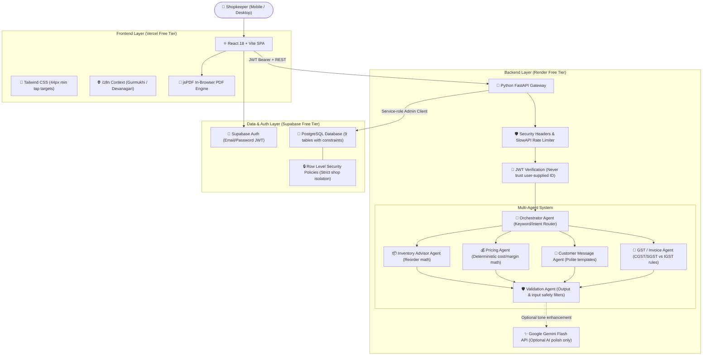

# DukaanMate — Technical Architecture & Teacher Presentation Guide

Use this document and diagram to explain the engineering decisions and architecture of DukaanMate.

---

## 🏗️ System Architecture Diagram

---

## 🎓 5 Key Technical Points to Highlight to Your Teacher

1. **Why Multi-Agent Instead of Single-Prompt AI?**
   - General LLMs frequently hallucinate numbers and make calculation mistakes when doing arithmetic in text.
   - In DukaanMate, **agents have distinct responsibilities**:
     - Arithmetic (pricing margins and GST percentages) is executed strictly in **Python code**, which is 100% deterministic and auditable.
     - The LLM is used **strictly for natural language polishing** if enabled. If the AI service is down or quota is reached, rule-based templates take over with zero disruption.

2. **Security & Zero-Trust JWT Model**:
   - The frontend never has access to database admin keys or LLM API keys.
   - The backend validates the cryptographic signature of the Supabase JWT token on every protected request and extracts the shopkeeper's unique ID directly from the token `sub` claim.

3. **Database Isolation with Row Level Security (RLS)**:
   - Every single table in PostgreSQL enforces RLS. Even if someone obtains an anon API key, Postgres verifies `auth.uid() = user_id`, making cross-tenant data leaks impossible.

4. **100% Free Hosting Stack**:
   - Built to run permanently without cloud bills:
     - Frontend on **Vercel**
     - Backend on **Render** (free tier with cold-start handler in UI)
     - Database & Authentication on **Supabase**
     - AI on **Google Gemini** free tier

5. **Accessibility for Non-Technical Local Users**:
   - Touch targets designed for real fingers on budget smartphones (44px minimum).
   - High contrast, simplified screens with single primary actions.
   - Native Unicode fonts for Punjabi (Gurmukhi) and Hindi (Devanagari).

